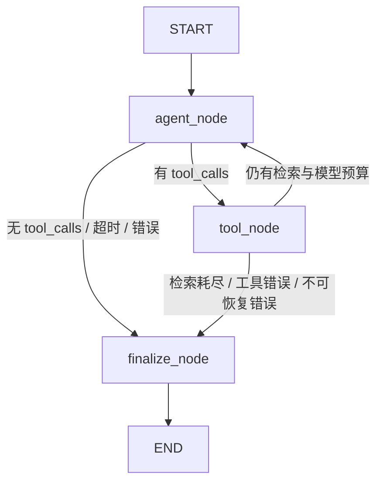

# DocPilot Agent V1

## 模块边界

沿用仓库实际的 `frontend/` 和 `backend/`，没有改名或搬迁现有功能。

```text
frontend/src/views/ChatView.vue
  → api/chatMode.js → api/chat.js → api/client.js（现有 Bearer）
  → POST /chat 或 POST /agent/chat
backend/app/main.py、agent_routes.py（认证依赖、请求/响应模型）
  → app/chat_service.py（会话归属、历史、身份重校验、原子保存）
    → 普通问答：app/knowledge.py → rag/pipeline.py
    → Agent：app/agent_service.py → agent/harness.py
        → agent/graph.py → agent/nodes.py → agent/state.py
        → agent/model_client.py（OpenAI Python SDK → DeepSeek）
        → agent/tools.py（只读、严格参数验证）
        → app/knowledge.search_evidence（服务端绑定权限语料）
  → rag/evidence.py（两种问答共用）
    → Dense + BM25 → RRF #1 → Reranker
    → RRF #2 + 意图感知 Reference 软降权 → 最终证据
  → Chroma；会话消息保存到现有 SQLAlchemy 数据库
```

调整前，证据检索与生成都在 `PaperRAGPipeline.answer`，`/chat` 路由还负责事务和消息保存。
调整后，`EvidenceRetriever.retrieve_evidence` 保存原来的检索流程，`PaperRAGPipeline` 继承它并继续执行原 Prompt 与 DeepSeek 生成。
API 调用共享的业务服务。Agent 与 RAG 在进程内直接调用，没有后端自请求 `/chat`。

主要文件职责：

|文件|职责|
|---|---|
|backend/rag/evidence.py|唯一共享证据链路，正式默认候选 20、最终 5、Reference penalty 4、第二次 RRF k=60|
|backend/rag/pipeline.py|复用证据服务，保留普通 RAG 的 Prompt、DeepSeek 和返回字段|
|backend/app/knowledge.py|读实际知识库，先按权限过滤全部文档，再构建 Dense/BM25；工具结果映射回真实 chunk|
|backend/agent/model_client.py|模型供应商边界，环境变量、SDK、tools/tool_choice 与消息响应适配|
|backend/agent/state.py|每次请求独立、可序列化的 AgentState 定义|
|backend/agent/nodes.py|agent/tool/finalize 节点、预算、超时、引用核验和条件路由|
|backend/agent/graph.py|构建 StateGraph、注册条件边并 compile，不使用 Checkpointer|
|backend/agent/harness.py|兼容旧调用入口，准备初始 State、调用 compiled graph、转换结果|
|backend/agent/tools.py|唯一工具定义、注册和严格参数验证|
|backend/app/agent_service.py|将可信身份的语料快照绑定给工具；管理模型客户端生命周期|
|backend/app/chat_service.py|两种问答共用的会话验证、身份重校验、事务写入|
|backend/app/agent_routes.py|新增 `/agent/chat` 的 HTTP 层|
|backend/app/models.py、migrations.py|可选 `messages.agent_metadata`；备份后增量迁移、保留旧消息|
|backend/app/conversations.py、schemas.py|读取消息时返回已保存的简短工具步骤|
|frontend/src/api/chat.js、chatMode.js|分别封装两种请求，复用原 API client/token|
|frontend/src/views/ChatView.vue|模式切换，复用消息、历史和 SourcePanel，展示简短检索步骤|
|evaluation/rag/run_agent_comparison.py|隔离数据库的同题 HTTP 对照，报告放 evaluation/reports/rag|

Dense、BM25、两次 RRF、Reranker、Chunk、Embedding 和原回答 Prompt 的算法、权重与正式配置未调整。
离线英文 Query / Weighted RRF 实验没有接入正式检索。

## 工具、权限和引用

模型只看到一个工具：

```json
{"name":"search_knowledge_base","arguments":{"query":"GENIE3 RcisTarget AUCell","top_k":5}}
```

`query` 必须是非空字符串且不超过 2000 字符，`top_k` 是 1–5 的整数。
`user_id`、`role`、知识库名、文档范围及其他字段都会被拒绝，身份来自 Bearer session，会话决定知识库。
权限矩阵沿用现有 employee/hr/admin 规则，同文档混合权限沿用较严格的可见性判断。
Dense 查询使用允许的 chunk IDs，BM25 只对授权语料建索引。工具不生成完整答案，也不调用 LLM。

返回结构是 `query`、`has_evidence`、`evidence`，每条证据含 `chunk_id`、`text`、`source`、`page`、`section`、`chunk_type`。
额外保留与现有来源面板兼容的 `id/index/page_start/page_end/knowledge_base`。
服务端给本轮不同 chunk 分配稳定的引用编号，最终数字引用必须属于本轮账本，否则返回证据不足答复。
只返回被最终引用的来源。这个验证保证编号和来源可追溯，不等于自动证明答案每句话都被证据蕴含。

最多执行两次检索；无效工具参数也会消耗工具尝试预算。并行 tool_calls 也受同一预算限制。
最多 4 次模型请求，默认单次模型 40 秒、单次工具 60 秒、Harness 总计 150 秒。
SDK 禁用自动重试。没有假设供应商支持 strict、parallel_tool_calls、reasoning_effort、temperature 或 response_format。
Tool Calling 的 assistant 消息先进入上下文，工具消息再携带相应 `tool_call_id`，参照 [OpenAI 官方 Function Calling 协议](https://developers.openai.com/api/docs/guides/function-calling)。

工具异常、无效参数、无证据或达到预算后，可在剩余轮次内请求模型结束；无可校验答案时返回固定的证据不足说明。
无证据时不接受模型凭记忆回答知识问题。简单问候可不检索。
历史只传用户问题帮助理解指代；旧答案和旧来源不能充当本轮证据。

超时等待使用有全局并发上限的后台线程，晚到结果不会进入消息或引用账本。Python 无法强制取消已启动的本地推理；超时后该只读推理可能短暂继续，最多 4 个后台任务。
当前仍沿用跨线程/进程知识库锁，长 Agent 轮次会占用锁；其他请求可能得到既有的 409 忙碌提示。这是 V1 延迟与吞吐限制。

## API

两种请求共享 Bearer 身份和 body：

```http
POST /agent/chat
Authorization: Bearer <登录得到的 token>
Content-Type: application/json

{"question":"GENIE3、RcisTarget 和 AUCell 分别承担什么职责？","conversation_id":1}
```

知识库从本人会话读取。其他人的会话返回 404；未登录返回 401；伪造身份 body 返回 422。
成功响应保留 `conversation_id/question/answer/sources/timings`，Agent 额外包含：

```json
{
  "conversation_id": 1,
  "question": "GENIE3、RcisTarget 和 AUCell 分别承担什么职责？",
  "answer": "当前证据不足，暂时无法给出有来源支持的回答。请补充问题细节或检查可访问文档。",
  "sources": [],
  "tool_trace": [{"step":1,"tool":"search_knowledge_base","status":"no_evidence","evidence_count":0,"elapsed_ms":12.3}],
  "timings": {"model_ms":100.0,"tool_ms":12.3,"total_ms":120.0},
  "stop_reason":"no_evidence",
  "retrieval_count":1,
  "model_call_count":2,
  "usage":{"prompt_tokens":0,"completion_tokens":0}
}
```

以上为结构示例，耗时和 token 不代表真实实测。带证据的实际响应保存在对照报告中。
停止原因包括 completed、no_evidence、search_limit、max_rounds、invalid_arguments、invalid_tool_call、tool_error、tool_timeout、model_error、model_timeout、total_timeout、invalid_citations、empty_answer、model_truncated。
异常正常结束的 Agent 答复可保存到原会话；如果 session 被撤销或角色改变，则不返回该答案，也不保存消息。
`/chat` 继续原有请求/响应及模型错误 HTTP 状态。`/history` 继续从统一消息表读取，不新建历史写入来源。

## 启动、测试和对照

沿用现有启动流程。后端 `.env` 使用已有 `DEEPSEEK_API_KEY`，可选 `AGENT_API_KEY/AGENT_MODEL/AGENT_BASE_URL`。
`AGENT_REQUEST_TIMEOUT/AGENT_TOOL_TIMEOUT/AGENT_TOTAL_TIMEOUT` 仅设置 Harness 超时。密钥不进入 Vue 或报告。
首次启动自动备份旧 SQLite 数据库并添加可空元数据列；旧回答和来源不改，迁移重复执行不会重复添加列。

```powershell
# 仓库根目录
.\.venv\Scripts\python.exe -m evaluation.run agent-comparison --mock
.\.venv\Scripts\python.exe -m evaluation.run agent-comparison --preview
# 需要外发许可和网络：问题与本次工具返回的论文片段发往配置的 DeepSeek
.\.venv\Scripts\python.exe -m evaluation.run agent-comparison --live
```

对照通过 FastAPI TestClient 请求两个真实路由，使用隔离内存数据库、临时 admin session、真实的现有权限语料。
不创建正式账号，不向现有会话写数据。报告每次独立存入 `evaluation/reports/rag/<UTC>-agent-v1/comparison.json`。
`--mock` 使用真实检索、精排、HTTP/认证/保存，但模型回复是模拟的，不能用于判断答案质量或真实 API 延迟。
`--live` 才验证真实模型 Tool Calling；失败或无真实工具往返明确标为 failed_or_inconclusive。
`--preview` 只保存本地问题与证据，模型调用为零。冷模型准备时间与 HTTP 总耗时分别记录。

```powershell
cd backend
..\.venv\Scripts\python.exe -m unittest tests.test_agent tests.test_agent_api tests.test_shared_evidence tests.test_agent_migration tests.test_knowledge_api tests.test_permissions tests.test_answer_resilience tests.test_prompt_style
cd ../frontend
node tests/chat-mode.test.mjs
npm.cmd run build
```

Agent 的预期收益是自主决定是否检索、改写一次检索及明确停止。一次成功工具往返至少需要两次模型请求，而固定 RAG 通常只需要一次；额外模型往返会增加延迟，不能预先宣称回答质量或速度一定更好。

## 本轮验证记录（2026-10-23）

后端指定测试共 55 项执行通过，覆盖工具协议与预算、无证据、异常、超时、引用、权限、会话撤销、原 `/chat`、共享证据顺序及增量迁移。
前端模式 API/参数/Bearer 测试通过；Vite 生产构建通过。`git diff --check` 无空白错误。

同一个 SCENIC 问题的本地 HTTP 对照使用真实语料、真实 Dense/BM25/两次融合/精排，模型为模拟：

|项目|普通 RAG|Agent|
|---|---:|---:|
|检索次数|1|1|
|模拟模型调用次数|1|2|
|HTTP 总耗时|13995.3 ms|18562.1 ms|
|返回来源条数|5|1（仅最终引用）|
|首条来源|paper-750，第 4 页|paper-750，第 4 页|

冷模型与检索预热单独耗时 149557.1 ms，不计入上述 HTTP 耗时。顺序运行存在 CPU/缓存波动；模型是模拟的，不能把 4566.8 ms 差值视作真实模型开销。
本地回答明确以“本地模拟回答”标识，来源的 chunk ID、文档名、起止页与授权语料逐项核验通过。
完整记录见 `evaluation/reports/rag/20261023T094251Z-agent-v1/comparison.json`。

授权前首次尝试时，沙箱内网络不可达：`evaluation/reports/rag/20261023T092818Z-agent-v1/comparison.json` 标为 failed_or_inconclusive；沙箱外请求也因尚未取得具体 payload 授权而被拒绝。取得本次明确授权后的有效验证结果如下。

## 实现审计与真实验证（2026-10-23）

提交 `f6b2c26` 的 Agent V1 基线使用自定义 Harness，不使用 LangGraph。循环入口是当时 `backend/agent/harness.py` 的 `Harness.run()`；状态保存在单次调用的局部变量中。以下真实验证数据属于该迁移前基线，用于确认迁移没有改变 API、工具协议、权限和引用约束。

在用户明确授权的受限范围内，使用问题“GENIE3、RcisTarget 和 AUCell 分别承担什么职责？”完成了一次真实 DeepSeek 验证。第一轮模型返回两个 `search_knowledge_base` tool calls；两组参数均通过 `SearchArguments` Schema，未显式传入的 `top_k` 均采用默认值 5。第二轮模型请求携带两个对应的工具结果 ID，随后生成最终回答。检索次数为 2，模型调用次数为 2，未超过限制；`usage` 为 2551 prompt tokens 和 208 completion tokens。最终引用 `[1][3][6]` 分别对应 `paper-750` 第 4 页、`paper-785` 第 9 页和 `paper-743` 第 4 页，并逐项通过当前授权语料校验。

|实测项目|普通 RAG|Agent V1|
|---|---:|---:|
|HTTP 状态|200|200|
|检索次数|1|2|
|模型调用次数|1|2|
|检索/工具耗时|307.4 ms 检索 + 11784.7 ms 精排|8719.0 ms + 8453.0 ms|
|模型耗时|10398.3 ms|4135.8 ms + 1841.9 ms|
|HTTP 总耗时|22762.5 ms|24824.6 ms|
|返回来源|5|3（仅最终引用）|

Agent 本次比普通 RAG 多 2062.1 ms，主要收益是模型自主提出两个不同检索式，并且只返回最终实际引用的来源；单次样本不足以证明稳定的质量提升。由于第一轮并行 tool calls 已用满两次检索预算，最终答案正常生成，但 `stop_reason` 保留为 `search_limit`，表示“达到检索上限后结束”，不表示请求失败。冷启动和检索预热另耗时 53324.9 ms，未计入两次 HTTP 对比。

完整脱敏记录保存在 `evaluation/reports/rag/20261023T100024Z-agent-v1/comparison.json`。报告包含逐轮模型耗时、实际工具参数、`tool_call_id` 往返、检索轨迹、usage、来源 chunk 和页码；不包含 API Key、Access Token、密码、真实用户身份、请求头、环境变量或完整 PDF。

本轮运行了仓库中全部包含 `unittest/TestCase` 的后端自动化模块，共 106 项通过；`/chat` 回归和 `/agent/chat` 本地模拟均包含在内，真实 `/agent/chat` 结果见上文。直接执行 `unittest discover` 会导入旧的 `tests/test_parsing_quality.py`，该文件在导入时立即解析 3 个完整 PDF、不是单元测试，约 20 分钟仍未结束，因此中止了这一旧手工入口；本轮按约束未修改它。Vue 模式测试通过，生产构建完成 108 个模块转换并通过。

## LangGraph 等价迁移

当前 Agent V1 已将编排层迁移为正式的 LangGraph `StateGraph`。它仍然是一个 Agent、一个模型和一个只读 RAG Tool，不是多智能体系统；没有 Main Supervisor、Research Subagent 或双模型配置。



`backend/agent/graph.py` 显式创建三个 Node、两组 Conditional Edges，并调用 `compile()`。`backend/agent/harness.py` 只保留兼容入口：准备初始 State、调用 compiled graph、转换原有响应结构；其中不再存在 Agent 主循环。

### AgentState

`backend/agent/state.py` 使用 `TypedDict` 定义每次请求独立的可序列化 State：

|字段|用途|
|---|---|
|messages|OpenAI-compatible 消息和完整 tool_call_id 往返|
|evidence_ledger|本轮真实 chunk、文档、页码和稳定引用序号|
|tool_trace|脱敏工具步骤、状态、证据数和耗时|
|retrieval_count / tool_attempt_count|实际检索数和消耗预算的工具尝试数|
|model_call_count|模型调用预算和统计|
|max_searches / max_model_calls|本次图调用的固定预算|
|usage|累计 prompt/completion tokens|
|started_at / deadline|请求开始时间和总截止时间|
|model_ms / tool_ms|累计模型与工具耗时|
|pending_tool_calls / seen_tool_call_ids|节点路由、重复执行保护和协议完整性|
|final_answer / validated_sources|后端核验后的最终输出|
|stop_reason / error|稳定停止原因和脱敏错误代码|
|permission_context|后端认证得到的知识库/角色上下文，不传给模型|
|question / latest_finish_reason|引用规则判断和供应商完成状态|

模型客户端、ToolRegistry 和授权检索闭包不进入 State，而是由每次请求新建的 Node 闭包持有，因此不会跨请求污染，也不会让模型传入 `user_id`、`role` 或文档范围。

### Node 与条件边

- `agent_node` 调用现有 ModelClient，累计模型调用、usage 和耗时，只解析回答或 tool_calls，不执行检索。
- `tool_node` 验证工具名和 Pydantic 参数，调用现有 ToolRegistry，维护证据账本并为每个有效 tool_call_id 生成对应工具消息。一次返回多个调用时只执行剩余预算；超出部分收到 `{"error":"search_limit"}`。
- `finalize_node` 在必要时执行一次禁用工具的最终模型调用，然后核验数字引用，只从 evidence ledger 构造 sources。无证据、超时或异常返回受控说明。
- `route_after_agent` 根据是否存在 pending tool_calls 选择工具或最终核验。
- `route_after_tool` 根据检索预算、模型预算和错误状态选择继续思考或最终核验。

检索上限保持 2 次，模型调用上限保持 4 次；默认模型单次超时 40 秒、工具超时 60 秒、总超时 150 秒。后台有界线程仍保证迟到结果不能写回 State。正常答案即使刚好用满两次检索也返回 `completed`；只有真正被额外工具调用阻断且没有正常完成时才保留 `search_limit`，超预算详情继续记录在 trace。

本轮没有启用 Checkpointer。会话、消息、来源与 Agent 摘要已经由现有 SQLAlchemy 数据库原子保存；再引入 LangGraph 持久化会形成两套会话真相源。当前图只处理一次 HTTP 请求内的短生命周期编排。

### 测试与图结构

```powershell
cd backend
..\.venv\Scripts\python.exe -m unittest tests.test_agent tests.test_agent_api tests.test_shared_evidence tests.test_answer_resilience

cd ..\frontend
node tests/chat-mode.test.mjs
npm.cmd run build
```

运行时可通过 `harness.graph.get_graph().nodes`、`harness.graph.get_graph().edges` 查看节点和边，也可调用 `harness.graph.get_graph().draw_mermaid()` 输出 Mermaid。测试会断言三个业务节点、START/END 边和 Harness 中不存在 `for/while` 主循环。

迁移后未执行真实 DeepSeek 请求；迁移前的受限真实验证结果保留在上一节。再次向外部模型发送论文证据需要单独明确授权。

迁移前 Agent 定向基线为 33 项通过；迁移后同范围加图结构、模型预算和并发隔离用例为 36 项通过。仓库中全部实际 `unittest/TestCase` 模块共 109 项通过，Vue 模式测试与 108 模块的生产构建通过，`pip check` 无依赖冲突。旧 `tests/test_parsing_quality.py` 仍是导入即执行三个完整 PDF 的手工解析入口，不属于 unittest 集合，本轮没有运行、修改或提交它。
